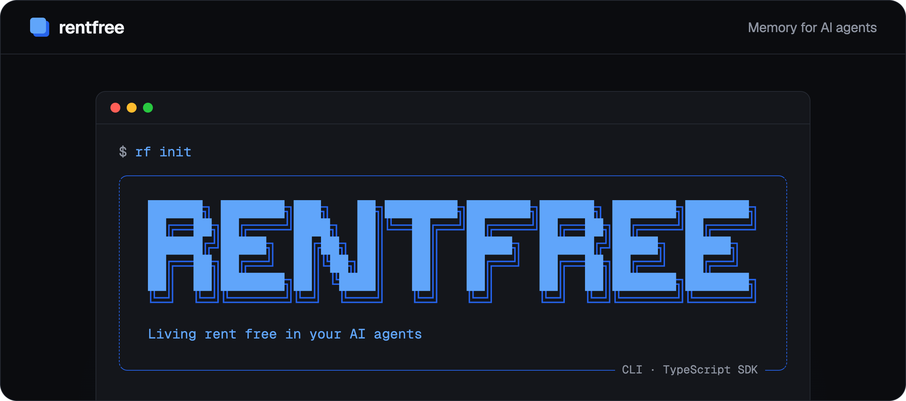

<p align="center">
  <a href="https://rentfree.dev">
    
  </a>
</p>

<p align="center">
  <a href="https://rentfree.dev">Website</a>
  ·
  <a href="https://rentfree.dev/docs/get-started">Get started</a>
  ·
  <a href="https://rentfree.dev/docs/cli">CLI reference</a>
  ·
  <a href="https://rentfree.dev/docs/api">API reference</a>
  ·
  <a href="https://github.com/rentfreeco/rentfree/releases">Changelog</a>
</p>

<p align="center">
  <a href="https://www.npmjs.com/package/@rentfree/cli"></a>
  <a href="https://www.npmjs.com/package/@rentfree/sdk"></a>
  <a href="https://github.com/rentfreeco/rentfree/actions/workflows/ci.yml"></a>
  <a href="https://www.npmjs.com/package/@rentfree/cli"></a>
  <a href="LICENSE"></a>
</p>

**rentfree gives coding agents a memory that lasts between sessions.** It captures what happens, turns it into memories, and hands back the right context for the next turn, within a token budget. This repository holds `rf`, its command line, and the TypeScript SDK `rf` is built on.

## Quick start

```sh
npm install -g @rentfree/cli

# Sign in through the browser; a first sign-in is a sign-up
rf init

# In your project: give Claude Code a memory of every session there
rf hooks install
```

That is all Claude Code needs. To try it by hand, write a memory and ask for the context a turn would get:

```sh
rf remember "Deploys go out from main, once CI is green." --type decision
rf context "how do we deploy?"
```

The [get started guide](https://rentfree.dev/docs/get-started) goes further, and the [concepts](https://rentfree.dev/docs/concepts) explain collections, sessions, recap, and memories.

## Built for agents

### Memory in every session

One command wires rentfree into Claude Code. Each session starts with what it remembers and is recapped when it ends, with no tokens spent on either.

```console
$ rf hooks install
Installed 4 hooks in .claude/settings.json:
event             command
SessionStart      rf hooks run session-start
UserPromptSubmit  rf hooks run prompt
Stop              rf hooks run stop
SessionEnd        rf hooks run session-end
```

### Context within a budget

One call returns what the next turn needs: the profile, then the memories and passages that bear on the question. Text for a model, JSON for a script.

```console
$ rf context "how do we deploy?"
## Memories
- Deploys go out from main once CI is green.
- Migrations run before the api deploys.
## From your documents
### runbook.md · Deploying
Run the release workflow from main.
```

### Every memory traceable

Each memory keeps the words it came from and every change made to it, so you can see why your agent believes something, and correct it.

```console
$ rf memories sources mem_8KfQ2
from                     quote
session ses_4tR event 9  deploy only from main
session ses_8Wm event 3  CI must pass first
source src_2Lk           release from main
```

## From code

The SDK is the same api, typed by the contract the api itself validates with:

```ts
import { createClient } from "@rentfree/sdk";

const rf = createClient({ apiKey: process.env.RF_API_KEY });

const { collections } = await rf.me.get();
const collectionId = collections.find((c) => c.isDefault)!.id;

// Text for the next turn's prompt, within a budget
const pack = await rf.context({
  collectionId,
  query: "how do we deploy?",
  tokenBudget: 1500,
});
console.log(pack.text);
```

## What is here

| Path                                                   | What it is                                                                           | On npm                                                         |
| ------------------------------------------------------ | ------------------------------------------------------------------------------------ | -------------------------------------------------------------- |
| [`packages/cli`](packages/cli)                         | `rf`, the command line                                                               | [`@rentfree/cli`](https://www.npmjs.com/package/@rentfree/cli) |
| [`packages/sdk`](packages/sdk)                         | The API's contract, its OpenAPI document, and the TypeScript client `rf` is built on | [`@rentfree/sdk`](https://www.npmjs.com/package/@rentfree/sdk) |
| `packages/eslint-config`, `packages/typescript-config` | The configs both build with                                                          |                                                                |

The rentfree service itself is not in this repository.

## Documentation

- [Get started](https://rentfree.dev/docs/get-started): from nothing to an agent with its own key, in a few minutes
- [Concepts](https://rentfree.dev/docs/concepts): accounts, keys, agents, collections, and how memories come to be
- [Claude Code hooks](https://rentfree.dev/docs/hooks): what each hook does, its options, and what was captured
- [CLI reference](https://rentfree.dev/docs/cli): every `rf` command, with what it sends and what it prints. The [`@rentfree/cli` readme](packages/cli/README.md) has the same in brief
- [API reference](https://rentfree.dev/docs/api): every endpoint, generated from the contract. The [`@rentfree/sdk` readme](packages/sdk/README.md) covers the TypeScript client

## Developing

Node.js 24 and pnpm, through Corepack:

```sh
corepack enable
pnpm install
pnpm build
pnpm test
```

`node packages/cli/dist/rf.mjs --help` runs the CLI you just built. It talks to `https://api.rentfree.dev` unless `--api-url`, `RF_API_URL`, or the address saved at login says otherwise.

## How this repository is kept

The CLI and SDK are developed beside the service, in a private repository, and every change to them is copied here as one commit. Issues and pull requests are welcome here. A pull request is applied in the private repository and comes back with the next copy, credited to you, rather than merged here, where the next copy would replace it. [CONTRIBUTING.md](CONTRIBUTING.md) has the details.

## Releases

Both packages are released together, at one version, from this repository. Each release's notes are on the [releases page](https://github.com/rentfreeco/rentfree/releases).

## License

[MIT](LICENSE)
